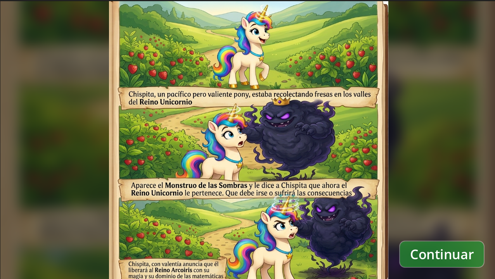
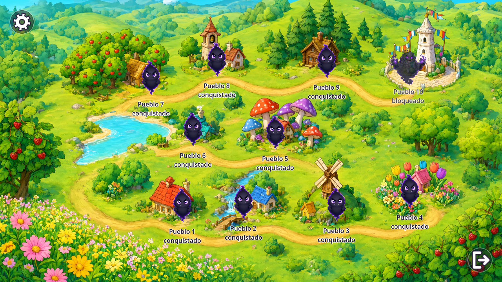
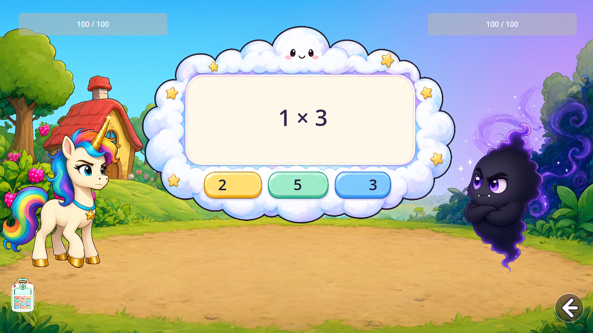
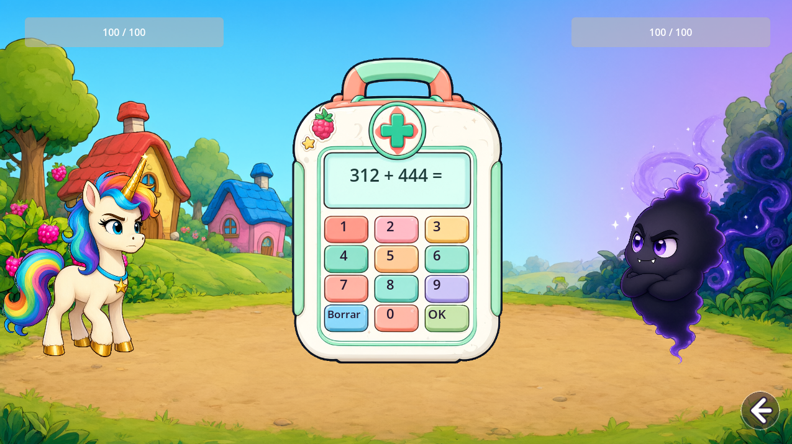
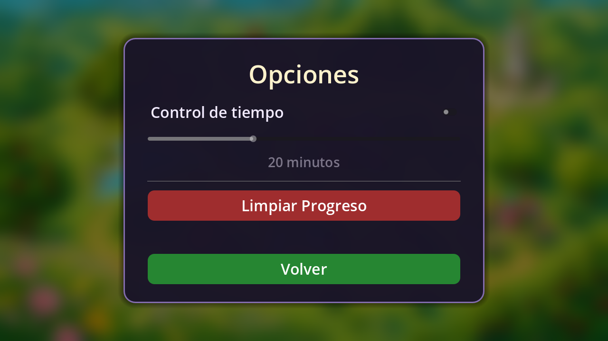

# Cómo jugar a Chispita y las Tablas Mágicas

Guía rápida para empezar a jugar, entender cada pantalla y saber qué hace
cada botón. Al final tienes un resumen de controles y algunos trucos para las
tablas de multiplicar.

## Antes de empezar

- **En Android:** instala el archivo `juego/JuegoChispita.apk` y abre
  _Chispita y las Tablas Mágicas_.
- **En ordenador:** abre la carpeta `juego/` con Godot 4.7 o superior y pulsa
  **F5** (o el botón de reproducir) para iniciar el juego.
- El progreso se guarda automáticamente, así que puedes cerrar el juego y
  continuar más tarde donde lo dejaste.

## 1. La introducción

Al empezar se muestra un pequeño cómic de tres viñetas:

1. Chispita, un pony pacífico pero valiente, recoge fresas en los valles del
   **Reino Unicornio**.
2. Aparece el **Monstruo de Sombras** y le dice que el reino ahora le
   pertenece.
3. Chispita decide liberar el reino con su magia y su dominio de las
   matemáticas.

Pulsa **Continuar** para ir al mapa.

## 2. El mapa del reino

El mapa muestra los **diez pueblos** unidos por un camino. Sobre cada pueblo
hay un monstruo y una etiqueta:

- **Conquistado:** el pueblo sigue cubierto por la oscuridad y puedes entrar
  a combatir.
- **Liberado:** ya has derrotado a su monstruo. Puedes volver a pulsarlo
  para **repasar** su tabla sin alterar el progreso guardado.
- **Bloqueado:** el **Pueblo 10** no se puede jugar hasta liberar los nueve
  pueblos.

Cada pueblo de secuaz repasa una tabla de multiplicar: el **Pueblo 1** trabaja
la tabla del **2**, el **Pueblo 2** la del **3**, y así hasta el **Pueblo 9**,
que repasa la del **10**. En el **Pueblo 10** espera el propio **Monstruo de
Sombras**.

Puedes entrar en cualquier pueblo que siga conquistado. Lo más cómodo es ir
en orden del 1 al 9, porque cada uno repasa una tabla distinta.

El **Monstruo de Sombras** está bloqueado hasta que liberes los nueve pueblos.
Si pulsas su pueblo antes de tiempo, te dirá que aún no estás listo.

### El jefe final

Cuando liberas el Pueblo 9 se desbloquea el Pueblo 10. El Monstruo de Sombras
no repasa una tabla fija: pregunta **diez multiplicaciones elegidas entre las
que más has fallado**. De cada tabla se toman las dos más falladas y, de esas
dieciocho candidatas, se quedan las diez peores. Así la última batalla repasa
justo lo que más te cuesta.

En la esquina superior izquierda está el botón de **opciones** (la rueda
dentada). Lo explico al final.

### Modo entrenamiento

Si activas el **Modo entrenamiento** en Opciones, al pulsar un secuaz aparece
primero la **tabla de su pueblo** en un panel con el botón **Aceptar**. Al
aceptar empieza la batalla; si prefieres no jugarla todavía, pulsa **Volver**.
El jefe final no muestra tabla porque su batalla mezcla varias.

En la esquina inferior derecha está el botón de **salir** del juego. Al pulsarlo
aparece la pregunta **¿Salir del juego?** con los botones **Sí** y **No**: solo
si pulsas **Sí** se cierra la aplicación.

## 3. La batalla

Al entrar en un pueblo empieza el combate:

- **Arriba:** dos barras de vida. A la izquierda la de Chispita y a la derecha
  la del monstruo. Ambos empiezan con **100 / 100**. En el centro se ve la tabla
  actual y el progreso, por ejemplo `Tabla del 7 · 3/10`; en un repaso aparece
  el prefijo `Repaso`.
- **Centro:** una nube baja con una multiplicación de la tabla del pueblo y
  **tres opciones**. Solo una es correcta.
- **Abajo a la izquierda:** el **botiquín médico**.
- **Abajo a la derecha:** la flecha para **volver al mapa**.

### Aciertos y fallos

| Resultado   | Qué ocurre                                                                                                                                                |
| ----------- | --------------------------------------------------------------------------------------------------------------------------------------------------------- |
| **Acierto** | Chispita lanza un rayo mágico desde su cuerno y quita **10 puntos de vida** al monstruo. Esa pregunta queda resuelta.                                     |
| **Fallo**   | El monstruo muestra la respuesta correcta y ataca con sombra, quitándole **10 puntos de vida** a Chispita. La pregunta puede volver a salir más adelante. |

El monstruo tiene 100 de vida y cada acierto quita 10, así que necesitas
**10 respuestas correctas** para ganar. Si fallas muchas veces y Chispita se
queda sin vida, pierdes el combate y tendrás que volver a intentarlo.

### El botiquín médico

Entre pregunta y pregunta puedes pulsar el botiquín de la esquina inferior
izquierda. Se abrirá con una **suma de tres cifras**, por ejemplo `312 + 444 =`.

1. Escribe el resultado con el **teclado numérico** de la tapa.
2. Pulsa **OK**.
3. Si la suma es correcta, Chispita recupera **30 puntos de vida**.
4. **Borrar** limpia la respuesta y cierra el botiquín sin gastarlo.

Solo puedes usar la curación **una vez por batalla**, así que conviene
guardarla para cuando de verdad te haga falta. Si te equivocas en la suma,
puedes volver a abrir el botiquín e intentarlo otra vez.

Al abrir el botiquín, la pregunta actual queda en pausa y vuelve a aparecer
cuando lo cierras.

### Ganar o perder

- **Victoria:** el monstruo cae, el pueblo se ilumina y queda marcado como
  **liberado** en el mapa. En el Pueblo 10 se reproduce una celebración
  especial.
- **Derrota:** si Chispita pierde toda su vida, el monstruo conserva el
  pueblo. Puedes volver al mapa y reintentar la batalla cuando quieras.

## 4. Opciones, sonido y control de tiempo

Pulsa la **rueda dentada** del mapa para abrir las opciones:

- **Control de tiempo:** actívalo con el interruptor y elige entre **15 y 30
  minutos** con el deslizador. Cuando se cumple el tiempo, el juego se pausa
  y muestra un aviso para descansar. El botón **Entendido** cierra el aviso y
  reinicia la cuenta.
- **Sonido:** apaga o enciende todo el audio del juego. Se guarda al instante.
- **Modo entrenamiento:** si está activo, antes de cada batalla de secuaz
  muestra la tabla del pueblo con un botón **Aceptar**.
- **Limpiar Progreso:** borra todos los pueblos liberados y el historial de
  fallos que usa el jefe final, y vuelve a empezar desde el Pueblo 1. Pide
  confirmación antes de borrar.
- **Volver:** regresa al mapa sin cambiar nada.

El control de tiempo está desactivado por defecto y la duración inicial es de
20 minutos.

## Resumen de controles

| Acción                           | Cómo se hace                                           |
| -------------------------------- | ------------------------------------------------------ |
| Pasar la introducción            | Botón **Continuar**                                    |
| Entrar a un pueblo               | Pulsar el pueblo conquistado en el mapa                |
| Repasar un pueblo liberado       | Pulsar el pueblo liberado en el mapa                   |
| Responder una multiplicación     | Pulsar una de las tres opciones de la nube             |
| Abrir el botiquín                | Pulsar el botiquín de abajo a la izquierda             |
| Escribir la suma                 | Teclado numérico de la tapa del botiquín               |
| Confirmar la suma                | Botón **OK**                                           |
| Borrar y cerrar el botiquín      | Botón **Borrar**                                       |
| Volver al mapa desde una batalla | Flecha de abajo a la derecha                           |
| Abrir opciones                   | Rueda dentada de arriba a la izquierda                 |
| Activar el modo entrenamiento    | Interruptor de la pantalla de opciones                 |
| Apagar el sonido                 | Interruptor de la pantalla de opciones                 |
| Enfrentar al jefe final          | Liberar los nueve pueblos y pulsar el Pueblo 10        |
| Cerrar el juego                  | Botón de salir de abajo a la derecha del mapa y **Sí** |

## Trucos para las tablas

- Si una pregunta te cuesta, piensa en la tabla como una suma repetida:
  `4 × 3` es `4 + 4 + 4`.
- Para la tabla del 5, el resultado siempre termina en **0** o en **5**.
- Para la tabla del 10, basta con añadir un **0** al otro número.
- Si dudas entre dos opciones, descarta primero las que no tengan sentido por
  el tamaño: `7 × 8` no puede dar 15.
- Guarda el botiquín para los momentos con poca vida: con 30 puntos recuperas
  tres fallos.

¡Buena suerte liberando el Reino Unicornio, Chispita!
